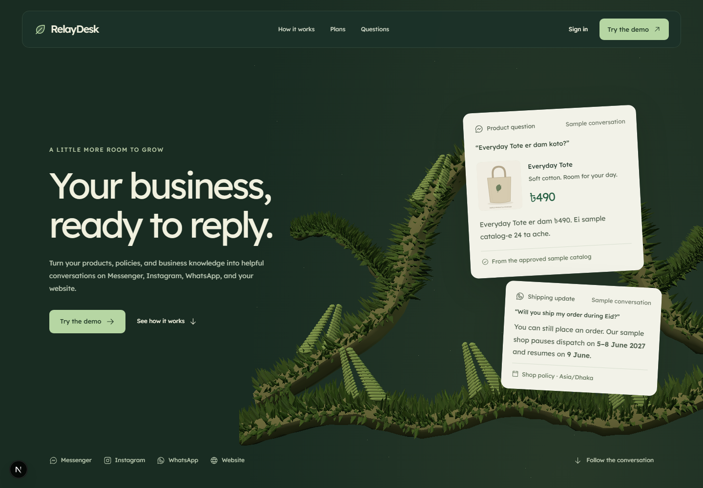
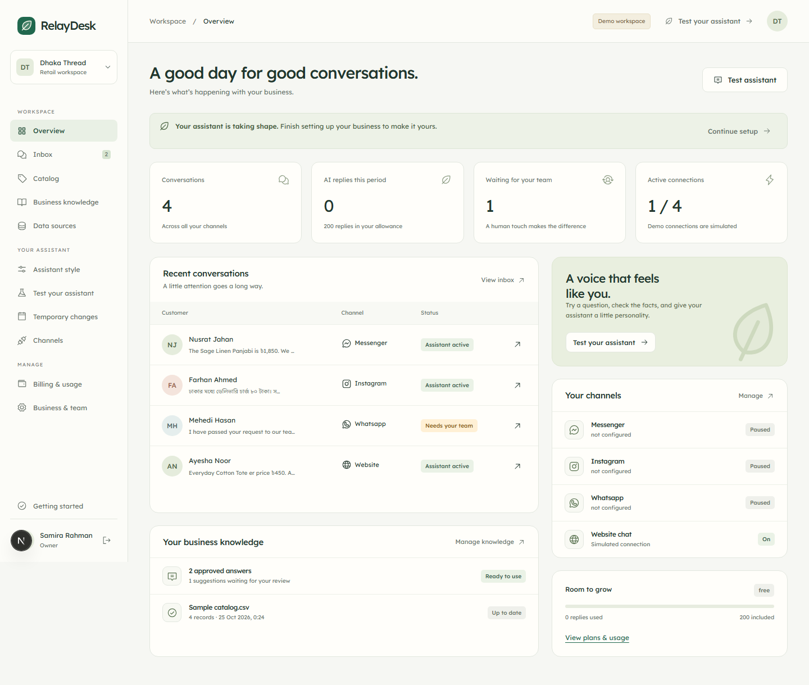
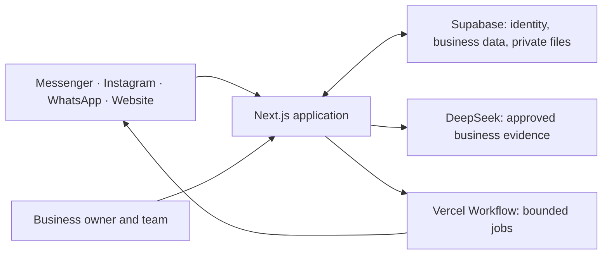

<div align="center">

# RelayDesk

### Your business, ready to reply.

Turn products, policies, and business knowledge into helpful customer conversations.<br>
Built for small businesses, starting with the way businesses work in Bangladesh.


[About](#about) · [Try it locally](#run-the-demo) · [What it does](#one-workspace-for-the-whole-conversation) · [Setup guides](#documentation)

</div>



## About

RelayDesk is a multichannel business assistant that helps small teams answer customer questions using their own approved products, policies, and business knowledge. It brings Messenger, Instagram, WhatsApp, and website conversations into one workspace, with staff ready to take over when a question needs human care.

**This is version 0.1 (package version 0.1.0): an early preview, not a finished production release.** The local demo is working, but features and interfaces may change. Payments are simulated, and live provider integrations still require configuration and validation. This first version focuses on proving the workflow for small businesses in Bangladesh, including English, Bangla, and Banglish conversations.

## The problem

A customer asks for a price on Messenger. Another asks about delivery on WhatsApp. Someone else sends an Instagram DM while the latest stock count sits in a spreadsheet.

For a small team, answering these questions means searching across tools, repeating the same information, and remembering what changed. A holiday shipping pause or an outdated price can turn a simple reply into a customer problem.

**RelayDesk brings the business's approved information and customer conversations into one place.** Owners decide what the assistant knows, how it replies, and when a person should take over. The goal is consistent information, less repetitive typing, and more room for the conversations that need human care.

## One workspace for the whole conversation

| Capability                       | What the business can do                                                                                          |
| -------------------------------- | ----------------------------------------------------------------------------------------------------------------- |
| **Four customer channels**       | Manage Messenger, Instagram, WhatsApp, and website chat through one inbox.                                        |
| **Knowledge the owner approves** | Import a catalog, review column mapping, publish FAQs, and keep drafts out of customer answers.                   |
| **Current product facts**        | Maintain prices, variants, stock, images, and source history. Unclear or stale information prompts clarification. |
| **Replies in familiar language** | Test English, Bangla, and Banglish conversations with configurable tone and reply length.                         |
| **Temporary business changes**   | Schedule shipping pauses, holiday notices, and opening-hour exceptions with explicit dates and timezones.         |
| **Human handover**               | Assign conversations, take over, reply as a team member, and resume the assistant when ready.                     |
| **Business boundaries**          | Use separate workspaces, owner/admin/agent roles, private uploads, exports, and retention controls.               |
| **Visible usage and limits**     | Review reply allowances, simulated subscription changes, and independent limits on real AI expenditure.           |

<details>
<summary><strong>See the business workspace</strong></summary>
<br>



Both screenshots show sample content. The people, businesses, conversations, and activity are synthetic.

</details>

## From business knowledge to a useful reply

1. **Bring your information.** Upload CSV/XLSX catalogs, text/Markdown/PDF documents, or documented chat exports. Google Sheets and read-only PostgreSQL/MySQL connectors are also implemented.
2. **Review before publishing.** Confirm columns, fix invalid rows, approve answers, and set the assistant's style. Historical conversations become drafts, never automatic policy.
3. **Test the answer.** Ask a realistic question in the playground and inspect its sources. Test a future date to check a scheduled notice.
4. **Connect and activate.** Authorize the selected business account through its official provider flow. Connection and automated replies are separate actions.
5. **Keep people in control.** Uncertain requests go to the team. Staff can stop automation and continue the conversation from the inbox.

The first templates are a clothing shop and a service business. Defaults use **BDT** and **Asia/Dhaka**, with configurable business settings. The dashboard has an English/Bangla localization foundation; detailed administration copy is currently English.

## Run the demo

**Requirements:** Node.js 22.11 or newer and npm 11. No external service credentials are needed for the local demo.

```bash
git clone https://github.com/rifatpriyo/RelayDesk.git
cd RelayDesk
npm ci
npm run setup:demo
npm run dev
```

Open **http://127.0.0.1:3000** and choose **Try the demo**. Explore **Dhaka Thread** or **Care & Repair**: two separate synthetic businesses with persistent local catalog, knowledge, conversations, and billing state.

The setup command creates `.env.local` only if it does not already exist, generates local secrets, and explicitly enables demo mode. Local data lives under `DEMO_DATA_DIR`. This filesystem adapter is for a private local preview; hosted instances use Supabase.

<details>
<summary>Windows installation note</summary>

If npm 10 reports an Arborist `edgesOut` error, use `npx --yes npm@11 ci`. This uses npm 11 for the installation without changing the global npm version.

</details>

## What is simulated, and what needs setup?

| Area                  | Local demo                                                    | Configured hosted instance                                                                                 |
| --------------------- | ------------------------------------------------------------- | ---------------------------------------------------------------------------------------------------------- |
| Data and identity     | Synthetic businesses, signed demo sessions, local persistence | Supabase Auth, PostgreSQL, and private Storage                                                             |
| Assistant replies     | Deterministic, clearly labeled demo responses                 | Server-side DeepSeek calls with explicit enablement and spend limits                                       |
| Social channels       | Seeded conversations and isolated provider fixtures           | Implemented adapters; requires Meta apps, permissions, merchant authorization, and review where applicable |
| Website chat          | Working local widget and inbox handover                       | Allowed website origins and scoped customer sessions                                                       |
| External data sources | Sample files and connector fixtures                           | Google OAuth or reachable read-only TLS database credentials                                               |
| Payments              | **Simulated checkout; no charge**                             | **Still simulated in this release**; SSLCOMMERZ is a future integration                                    |

Live Meta, Google, DeepSeek, Supabase RLS/Storage, and external database connections have **not** been validated with real accounts. Fixture tests do not establish live-provider readiness. Start with the [integration guide](docs/INTEGRATIONS.md) and [manual deployment guide](docs/DEPLOYMENT.md) when configuring your own environment.

## Built as one application



Next.js App Router and TypeScript handle the workspace, API routes, callbacks, and webhooks. Supabase provides production persistence and authentication. Durable jobs record processing and delivery state; uncertain sends require reconciliation instead of automatic duplication. See [Architecture](docs/ARCHITECTURE.md) for tenant boundaries, retrieval, and transaction design.

## Verification

Recorded local checks on **25 October 2026**:

- **150 unit and integration tests passed**, including a roughly 30-question multilingual evaluation.
- **19 browser scenarios passed** across desktop and mobile, plus tablet visual review. One duplicate viewport-independent HTTP test was intentionally skipped.
- **TypeScript and the production build passed.** The normal WebGL scene, reduced-motion layout, and WebGL fallback were reviewed.

```bash
npm run typecheck
npm test
npm run build
npx playwright install chromium
npm run test:browser
```

Stop the development server before building or running browser tests. Playwright starts its own disposable local server on port 3100. Run `npm start` after a successful build to preview the production bundle. Full evidence and current limitations are in [Build status](docs/BUILD_STATUS.md).

## Credentials stay outside the repository

Use [`.env.example`](.env.example) as the configuration reference. Put real values in a private `.env.local` file or the hosting provider's secret settings. Environment files, local business data, logs, test traces, and generated build artifacts are excluded by `.gitignore`.

Server keys and merchant credentials must never go into `NEXT_PUBLIC_` variables. Real AI usage has separate operator budgets; a simulated plan upgrade cannot raise those limits. Review [Security](docs/SECURITY.md) for private files, credential rotation, retention, backup, and restore procedures.

Before future commits, stage the intended files and run `npm run check:publication`. This checks the Git index for private paths, common secret formats, and exact sensitive values from local environment files without printing those values. Review changes as well; automated scanning is an additional check, not a guarantee.

## Documentation

| Guide                                              | Read it for                                                         |
| -------------------------------------------------- | ------------------------------------------------------------------- |
| [Architecture](docs/ARCHITECTURE.md)               | Domains, tenant isolation, retrieval, jobs, and persistence         |
| [Integrations](docs/INTEGRATIONS.md)               | Meta, Google Sheets, database connectors, and provider requirements |
| [Mock billing](docs/MOCK_BILLING.md)               | Checkout states, entitlements, renewals, and cost boundaries        |
| [Deployment](docs/DEPLOYMENT.md)                   | Manual Supabase/Vercel setup and stable callback URLs               |
| [Security](docs/SECURITY.md)                       | Roles, private files, secrets, retention, and recovery              |
| [Design](docs/DESIGN.md)                           | Visual system, native-scroll story, accessibility, and fallbacks    |
| [Build status](docs/BUILD_STATUS.md)               | Executed checks, limits, and remaining external setup               |
| [Third-party notices](docs/THIRD_PARTY_NOTICES.md) | Dependencies, fonts, assets, and preserved attribution              |

The marketing scene adapts the licensed ThreeUI Community source; provenance and notices are preserved under [`references/threeui`](references/threeui/REFERENCE_NOTES.md). RelayDesk is a provisional product name. Privacy, terms, and deletion pages contain owner-supplied details to complete before public use.
